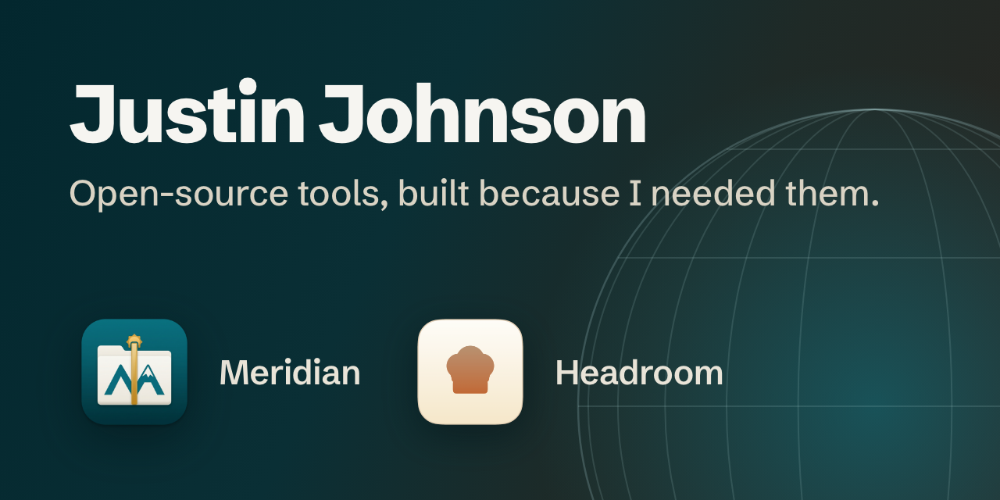

I build the tools I need and share them.

### Mac apps

- [Headroom](https://github.com/BioInfo/headroom): a menu-bar gauge for how much of your AI coding subscriptions you have left. Claude, Codex, Grok, GLM, MiniMax and Kimi in one place.
- **Meridian** (coming soon): a native macOS file manager with Explorer habits, Obsidian-style Markdown and bring-your-own-key AI.

### Editor extensions

- [MarkItDown for VS Code](https://github.com/BioInfo/vscode-markitdown): right-click a PDF, Word doc, slide deck or spreadsheet and get clean Markdown next to it. 79,550 installs on the [Marketplace](https://marketplace.visualstudio.com/items?itemName=bioinfo.markitdown-vscode).

### Claude Code

- [slopless](https://github.com/BioInfo/slopless): the CLAUDE.md, rules and hooks I use to get better code and more human writing out of Claude Code.
- [claudelicious](https://github.com/BioInfo/claudelicious): the wiring behind a full Claude Code harness. Skills, hooks, memory, routing and always-on agents, and why each one is there.
- [mneme](https://github.com/BioInfo/mneme): semantic search over your Claude Code session history. Runs locally, no cloud and no API keys.

### Inference on the DGX Spark

- [dendrite](https://github.com/BioInfo/dendrite): faster serving for kev decision models. Question branches share one cached state, so branch time stops growing with document length.
- [turboquant-dgx](https://github.com/BioInfo/turboquant-dgx): TurboQuant KV cache quantization, 1,000 experiments on a GB10. 3.88x compression at 4-bit.

### Bioinformatics and research

- **freec-rs** (coming soon): a Rust rewrite of Control-FREEC, output-compatible with v11.6b.
- [ModelMap](https://github.com/BioInfo/ModelMap): tells you which class of genomic AI model fits your task before you rank any of them. [Live demo](https://modelmap.vercel.app).
- [ARIA](https://github.com/BioInfo/aria-paper): companion code for a preprint on research agents that keep running for months.

### Robots

- [reachy](https://github.com/BioInfo/reachy): apps and experiments for the Reachy Mini Lite robot. The build log is at [runreachyrun.com](https://runreachyrun.com).

### Where I write

- [Run Data Run](https://rundatarun.io), my Substack.
- [AIXplore](https://ai.rundatarun.io), the technical blog.
- [Builder-Leader](https://builder-leader.com): my book on doing knowledge work through a multi-agent harness.
- X: [@builderleader](https://x.com/builderleader)

My company is [J&S Group LLC](https://jandsgroupllc.com).

### Support

If something here saves you time, you can [sponsor me on GitHub](https://github.com/sponsors/BioInfo) or [buy me a coffee](https://buymeacoffee.com/justinhjohnson).
